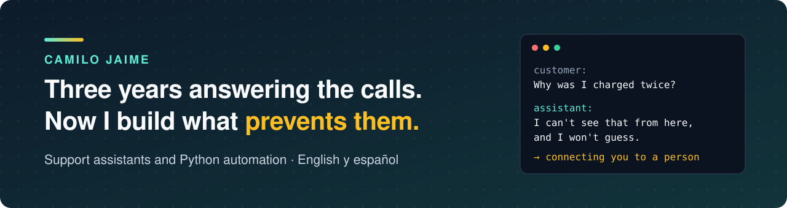

  

Hi, I'm Camilo.

For three years my job was picking up the phone when something had gone wrong with someone's bank account. Locked out, card declined, a payment that never arrived. In English and in Spanish, one call after another.

You learn things on those calls that no tutorial teaches. Most people ask the same handful of questions. A wrong answer costs more than no answer. And the worst thing a company can do is make a customer explain the problem twice.

I also study computer science at Universidad Nacional de Colombia. So I started building the tools I wished I'd had on those calls.

## What I build

**Support assistants that know when to stop talking.** They answer from your own help centre, show the customer which article the answer came from, and hand over to a person the moment they aren't sure. I've been the person on the other end of a bot that guessed. I don't build those.

**Automation for the work nobody should do by hand.** The report someone compiles every Monday, the audit nobody has time for, the copy-paste between two systems. Written in Python, with tests, so it still works in six months.

**Websites that load fast and say one thing clearly.** Next.js and TypeScript, built so you can change the text yourself.

## What I'm working on

- **[AnswerDesk](https://github.com/RawBud11/answerdesk)** is the support assistant described above, built in the open. It is early: the foundation is in place and the chat is next. I'm publishing how often it gets answers right, in both languages, because "trust me, it works" isn't good enough for something that talks to your customers.
- **[A neural network that solves a physics problem backwards](https://github.com/RawBud11/pinn-1d-diffusion-inverse)**. Given noisy measurements, it works out the hidden property of the material that produced them, to within 0.17%. Nothing to do with customer support, but it shows how I work: measure it, then show the measurement.

## What it's like to work with me

- **I'll tell you when I don't know.** Same rule I give the bots.
- **You'll understand what you're paying for.** A written plan and a fixed first milestone before any work starts, in plain language.
- **You won't be stuck with me.** Everything comes with tests and instructions, so another developer can pick it up.
- **I use AI coding tools, and I'm upfront about it.** I review and test everything I hand over, and I can explain every line.

## Let's talk

Tell me about your customers and what your team answers all day. I'll tell you honestly whether I can help.

  

Manizales, Colombia · UTC-5, so I'm awake when the US is · También trabajo en español.
